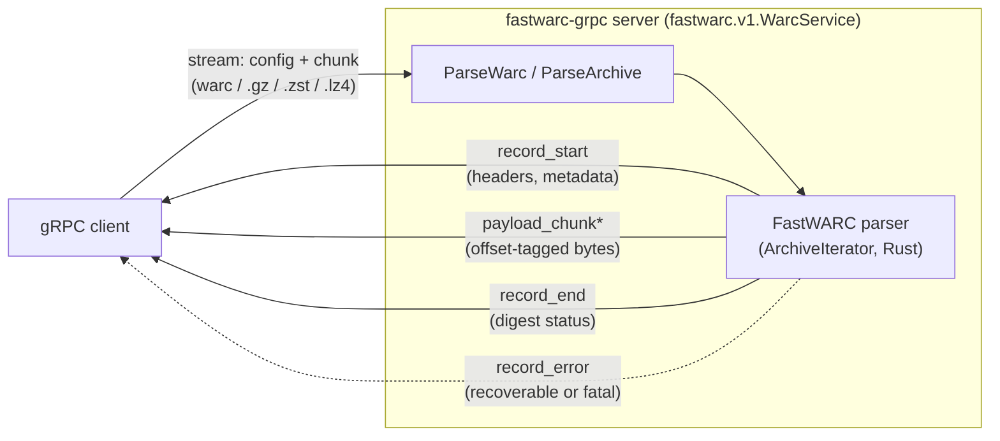

# ChatNoir Resiliparse

[](https://github.com/chatnoir-eu/chatnoir-resiliparse/actions/workflows/build-packages.yml)
[](https://codecov.io/gh/chatnoir-eu/chatnoir-resiliparse)
[](https://resiliparse.chatnoir.eu/en/latest/?badge=latest)

A collection of robust and fast processing tools for parsing and analyzing web archive data written in Rust and
Cython/C++ with bindings for Python.

## Usage Instructions

For detailed information about the build process, dependencies, APIs, or usage instructions, please read
the [Resiliparse Documentation](https://resiliparse.chatnoir.eu/en/latest/index.html)

## Resiliparse Module Summary

The Resiliparse collection encompasses the following two modules at the moment:

### 1. Resiliparse

The Resiliparse main module with the following subcomponents:

#### Parsing Utilities

The Resiliparse Parsing Utilities are highly optimized tools for dealing with encodings, detecting content types of raw
protocol payloads, parsing HTML web pages, performing language detection, and more.

Main documentation: [Resiliparse Parsing Utilities](https://resiliparse.chatnoir.eu/en/latest/man/parse.html)

#### Extraction Utilities

The Resiliparse Extraction Utilities are a set of performance-optimized and highly efficient tools for extracting
structural or semantic information from noisy raw web data for further processing, such as (main) content extraction /
boilerplate removal, schema extraction, general web data cleansing, and more.

Main documentation: [Resiliparse Extraction Utilities](https://resiliparse.chatnoir.eu/en/latest/man/extract.html)

#### Process Guards

The Resiliparse Process Guard module is a set of decorators and context managers for guarding a processing context to
stay within pre-defined limits for execution time and memory usage. Process Guards help to ensure the (partially)
successful completion of batch processing jobs in which individual tasks may time out or use abnormal amounts of memory,
but in which the success of the whole job is not threatened by (a few) individual failures. A guarded processing context
will be interrupted upon exceeding its resource limits so that the task can be skipped or rescheduled.

Main documentation: [Resiliparse Process Guards](https://resiliparse.chatnoir.eu/en/latest/man/process-guard.html)

#### Itertools

Resiliparse Itertools are a collection of convenient and robust helper functions for iterating over data from unreliable
sources using other tools from the Resiliparse toolkit.

Main documentation: [Resiliparse Itertools](https://resiliparse.chatnoir.eu/en/latest/man/itertools.html)

### 2. FastWARC

FastWARC is a high-performance WARC parsing library for Python written in Rust with bindings for Python.
compressed and uncompressed WARC/1.0 and WARC/1.1 streams. Supported compression algorithms are GZip, Zstd, and LZ4.

Main documentation: [FastWARC](https://resiliparse.chatnoir.eu/en/latest/man/fastwarc.html)
and [FastWARC CLI](https://resiliparse.chatnoir.eu/en/latest/man/fastwarc-cli.html)

## gRPC server (this fork)

This is the `ai-pipestream` fork of chatnoir-resiliparse. It does not change
Resiliparse or FastWARC themselves; it adds one thing upstream does not have:
a streaming gRPC server, `fastwarc-grpc/`, that puts the `fastwarc` Rust WARC
parser behind a `fastwarc.v1.WarcService` gRPC interface. The server is pure
Rust with no Python/Cython in the path, and depends on the `fastwarc` crate
only through a normal path dependency, so the parser itself stays untouched.

At the time of writing this crate lives on this fork's `fastwarc-grpc-parallel`
branch and has not yet been merged into `develop`; nothing below is upstream
ChatNoir/Webis content.

`WarcService` exposes two RPCs over the same parse pipeline:

- `ParseWarc` (bidirectional streaming): the client sends one `config`
  message followed by archive bytes as `chunk` messages (plain, or gzip/zstd/
  lz4-compressed, auto-detected from magic bytes). The server streams back,
  per kept record, a `record_start` (full lossless header metadata), zero or
  more `payload_chunk` messages, and a `record_end` (payload length, digest
  verification). A bad HTTP sub-parse yields a recoverable `record_error`;
  a broken WARC framing yields a non-recoverable one and ends the stream.
- `ParseArchive` (unary): the whole archive in one request, every kept
  record (metadata, full payload, digest status) in one response, for
  archives that fit inside the gRPC message size limit.



Other notable details, mostly relevant to operators:

- `ParseWarcConfig.archive_path` lets the server open a local file instead
  of accepting uploaded bytes; it is rejected with `PERMISSION_DENIED`
  unless the server opts in (`FASTWARC_GRPC_ALLOW_LOCAL_FILES=1`), since it
  otherwise grants any client read access to the server's filesystem.
- `parallelism` (config field, `ParseWarc` only) cuts a gzip-per-record
  archive at validated member boundaries and parses segments on multiple
  workers; records then arrive interleaved and are correlated by
  `record_index` rather than file order.
- `grpc.health.v1.Health` and gRPC server reflection (v1) are both served,
  so `grpcurl` can introspect and call `WarcService` without local copies
  of the `.proto` files.

See `fastwarc-grpc/README.md` and `fastwarc-grpc/DESIGN.md` (on the
`fastwarc-grpc-parallel` branch) for the full protocol reference, the
lossless WARC-to-protobuf field mapping, and build/run instructions.

## Installation (Rust)

To use FastWARC as a library in your Rust project, add the following to your `Cargo.toml`:

```toml
[dependencies]
fastwarc = "*" # Specify the correct version here
```

Then build your project like normal with `cargo build`.

Resiliparse is not yet available as a stable crate.

## Installation (Python)

Pre-built wheels are available for Linux, macOS, and Windows on PyPi, which can be installed via `pip`:

Resiliparse:

```bash
pip install resiliparse
```

FastWARC:

```bash
pip install fastwarc
```

### Building Bindings From Source

You can also build the Resiliparse and FastWARC Python bindings yourself from source. FastWARC has been fully ported to
Rust. Resiliparse is still written in Cython.

For detailed build instructions, please refer to
the [build documentation](https://resiliparse.chatnoir.eu/en/stable/man/installation.html) or the individual READMEs:

- [Resiliparse](resiliparse-py/README.md)
- [FastWARC](fastwarc-py/README.md)

## Cite Us

Resiliparse is part of the [ChatNoir](https://chatnoir.eu/) web analytics toolkit. If you use ChatNoir or any of its
tools for a publication, you can make us happy by citing
our [ECIR 2018 demo paper](https://webis.de/downloads/publications/papers/bevendorff_2018.pdf):

```bibtex
@InProceedings{bevendorff:2018,
  address =             {Berlin Heidelberg New York},
  author =              {Janek Bevendorff and Benno Stein and Matthias Hagen and Martin Potthast},
  booktitle =           {Advances in Information Retrieval. 40th European Conference on IR Research (ECIR 2018)},
  editor =              {Leif Azzopardi and Allan Hanbury and Gabriella Pasi and Benjamin Piwowarski},
  month =               mar,
  publisher =           {Springer},
  series =              {Lecture Notes in Computer Science},
  site =                {Grenoble, France},
  title =               {{Elastic ChatNoir: Search Engine for the ClueWeb and the Common Crawl}},
  year =                2018
}
```

If you use FastWARC, you can also cite our [OSSYM 2021 abstract paper](https://arxiv.org/abs/2112.03103):

```bibtex
@InProceedings{bevendorff:2021,
  author =                {Janek Bevendorff and Martin Potthast and Benno Stein},
  booktitle =             {3rd International Symposium on Open Search Technology (OSSYM 2021)},
  editor =                {Andreas Wagner and Christian Guetl and Michael Granitzer and Stefan Voigt},
  month =                 oct,
  publisher =             {International Open Search Symposium},
  site =                  {CERN, Geneva, Switzerland},
  title =                 {{FastWARC: Optimizing Large-Scale Web Archive Analytics}},
  year =                  2021
}
```

